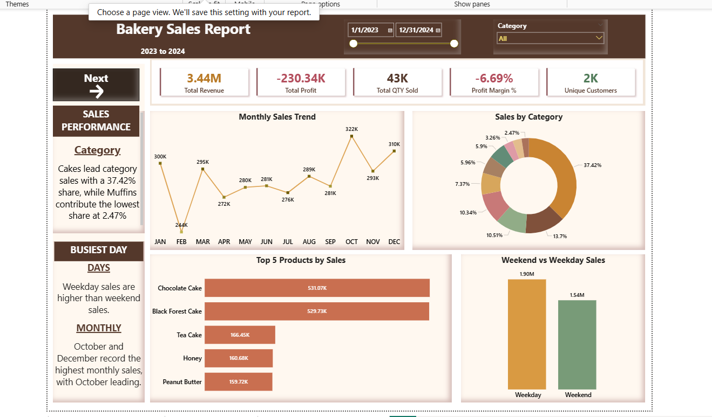
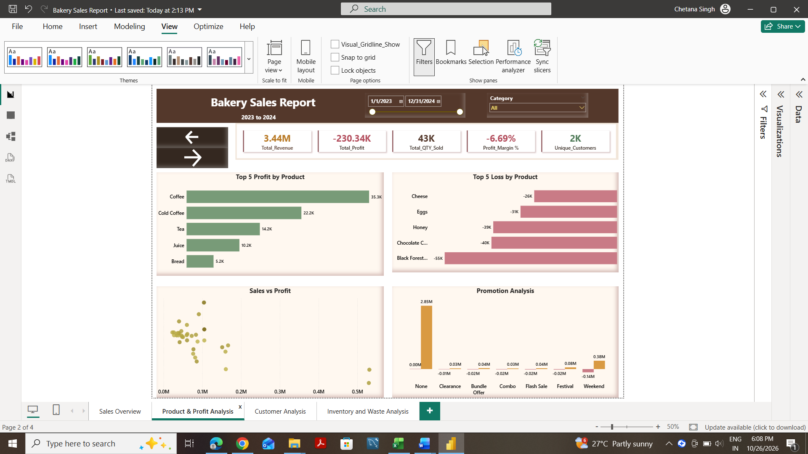
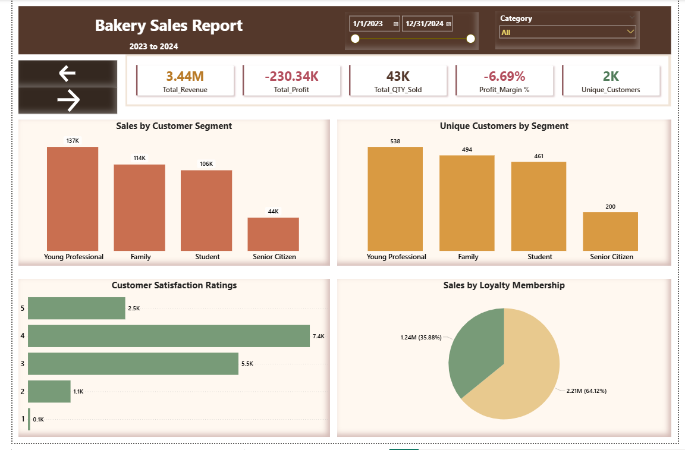
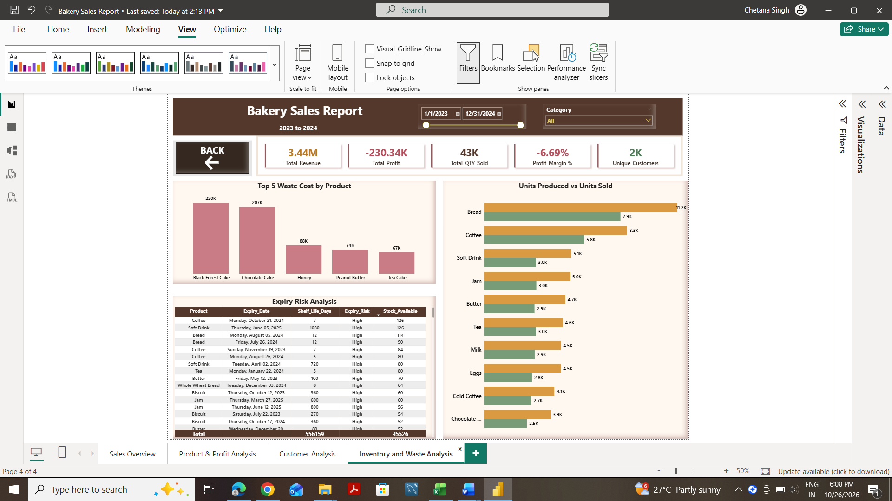

# Bakery Sales Analysis | SQL & Power BI

## Project Overview

This project analyzes bakery sales data using MySQL and Power BI to understand sales performance, product profitability, customer behavior, and inventory waste.

The objective is to identify business trends, evaluate profitability, understand customer purchasing patterns, and highlight opportunities for operational improvement.

## Tools Used

- MySQL — Data analysis and SQL queries
- Power BI — Interactive dashboards and data visualization
- Excel/CSV — Dataset preparation

## Dashboard Pages

**1. Sales Overview**

Analyzes revenue, quantity sold, sales by category, top-selling products, monthly sales trends, and weekday versus weekend performance.

**2. Product & Profit Analysis**

Examines profitable and loss-making products, sales versus profit, and promotional performance.

**3. Customer Analysis**

Explores customer segments, unique customers, satisfaction ratings, and loyalty membership.

**4. Inventory & Waste Analysis**

Analyzes waste costs, expiry risks, and units produced versus units sold.

## Key Business Insights

- Cakes contribute 37.42% of category sales, while Muffins contribute 2.47%.
- Weekday sales exceed weekend sales.
- October records the highest combined monthly sales.
- Total revenue is approximately 3.44M.
- Total profit is approximately -230.34K, with a profit margin of -6.69%, highlighting a profitability concern.

## Business Recommendations

- Review loss-making products and their cost structures.
- Investigate inventory waste and expiry-risk products.
- Evaluate promotional effectiveness.
- Use customer and product sales patterns to support inventory and marketing decisions.

## Project Files
- [Power BI Dashboard (.pbix)](Bakery%20Sales%20Report.pbix)
- [SQL Analysis Script](SQL%20Script.sql)
- [Bakery Dataset (.csv)](Bakery_dataset.csv)

## Conclusion

This project demonstrates how SQL and Power BI can transform transactional bakery data into actionable business insights, supporting better sales, profitability, customer, and inventory decisions.
